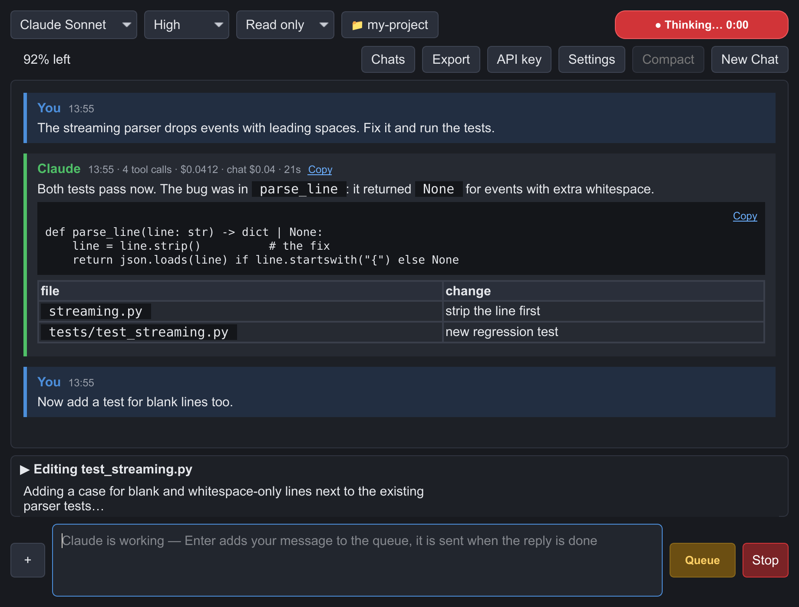

# AI Chat (aichat-desktop)

A desktop chat window for [Claude Code](https://claude.com/claude-code). It runs the `claude` command for you and gives
it a proper window: live progress, a project folder per chat, saved chats, safe permission modes, queued messages and an
optional credit counter.



<sub>Dark theme, a reply streaming in. A [light theme](docs/screenshot-light.png) is built in too.</sub>

> Not affiliated with or endorsed by Anthropic. "Claude" and "Claude Code" are Anthropic's names; this is an independent
> project that drives the `claude` command you installed yourself.

## Features

- **Live streaming**: while Claude works you see what it is doing (`Reading app.py`, `Running: pytest`) and the answer as it is written, not only when the whole turn is done.
- **Project folder**: pick the folder Claude works in (default: your home). A chat belongs to one folder.
- **Permission modes** (next to the model box): **Read only** (default: Claude can read and search, nothing else), **Edit files**, **Full auto** (anything, asks you to confirm first). What a mode forbids is refused, and the reply tells you which tool was refused.
- **Saved chats**: every chat is kept; **Chats** lists, opens, renames and deletes them. The open chat comes back after a restart.
- **Copy and export**: a *Copy* link on every reply and every code block; **Export** saves the chat as Markdown.
- **Message queue**: keep typing while Claude works; messages go out one by one. Stop pauses the queue.
- **Rendered replies**: headings, tables, lists, code blocks, links. Replies are HTML-escaped first.
- **Themes**: dark, light, "dark window with light chat", or follow the desktop (Settings → Colours); switches live.
- **Images**: paste a screenshot (Ctrl+V) or attach files.
- **Cost view** (optional): per-reply and per-chat cost, a "N% left" credit counter, the context size and a **Compact** button.

## Install

You need **Python 3.10+**, **Qt 6 for Python (PyQt6)** and the **`claude` command** (install it from
<https://claude.com/claude-code> and run `claude` once to sign in). Developed and tested with Claude Code 2.1; the window
passes `--effort`, `--include-partial-messages` and `--permission-mode`, so very old versions will not work.

```bash
# from a checkout, any of these
pipx install .            # or: uv tool install .
pip install .             # inside a virtualenv
sudo apt install ./dist/aichat-desktop_*.deb      # Ubuntu / Debian, after packaging/build-deb.sh

aichat-desktop --install-desktop    # optional, pipx / pip installs: adds "AI Chat" to the application menu
aichat-desktop
```

Run from a checkout without installing: `pip install PyQt6 && python3 -m aichat_desktop`.

### Packages

| Format | How | Status |
|---|---|---|
| `.deb` | `packaging/build-deb.sh` → `dist/aichat-desktop_<version>_all.deb` (needs only `dpkg-deb`; depends on `python3-pyqt6`) | built; installed, configured, verified and purged in a scratch root with `dpkg`; desktop file and AppStream data validated |
| AppImage | `packaging/build-appimage.sh` (python-appimage + appimagetool, bundles Python 3.12 and PyQt6, needs network) | built (about 100 MB); started on a private X screen. Bundles Python and Qt but not the graphics stack: needs the usual desktop libraries (`libegl1`, `libgl1`, `libxkbcommon0` on a minimal system) |

### Windows

The code avoids Linux-only calls (config in `%APPDATA%\aichat-desktop`, `claude.exe` is preferred over the npm
`claude.cmd` shim, no console window flashes, UTF-8 pipes, a windowed `aichat-desktop.exe` from `pip install .`). Claude
Code on Windows needs [Git for Windows](https://git-scm.com/download/win). **This has not been run on a real Windows
machine.** CI has a Windows test job that reports but does not block; `--install-desktop` and the packages are Linux
only (pin `aichat-desktop.exe` to the Start menu yourself). Bug reports from Windows users are very welcome.

## First start

A short dialog asks how you pay for Claude: a **subscription** (nothing to enter, `claude` is already signed in) or an
**API key** (checked against Anthropic, then saved), and optionally your **starting credit** in USD for the "N% left"
counter. Skip it and change everything later under **Settings** / **API key**.

## Where things are stored

Everything is in the `aichat-desktop` folder of your user config: `~/.config/aichat-desktop` (or
`$XDG_CONFIG_HOME/aichat-desktop`, or `$AICHAT_DESKTOP_CONFIG_DIR`), `%APPDATA%\aichat-desktop` on Windows.

| File | Content |
|---|---|
| `env` | `ANTHROPIC_API_KEY=…` (mode 0600; a key in your environment is used when this has none) |
| `settings.json` | model, effort, permission mode, theme, project folder, `claude` path, credit |
| `chats/<id>.json` | one file per chat (mode 0600) |
| `usage.json` | spend counter |
| `icon.png` | optional: your own window icon |

Versions before 0.3 used a folder called `aichat` (a name other programs use too); the first start of 0.3 moves only
its own files from there.

The key is only ever shown masked (`sk-ant-…abcd`) and is passed to `claude` through its environment.

## Permission modes in detail

`claude -p` (the mode this window uses) cannot stop and ask a question, so "ask first" is not possible; each mode instead
allows a fixed set of tools and refuses the rest:

| Mode | `claude` arguments | Claude can |
|---|---|---|
| Read only | `--permission-mode default --allowedTools Read,Glob,Grep,WebFetch,WebSearch` | read, search, browse |
| Edit files | `--permission-mode acceptEdits --allowedTools …,Edit,Write,NotebookEdit` | also change files in the folder |
| Full auto | `--dangerously-skip-permissions` | everything a shell user can do |

## Security notes

- **Full auto** lets Claude run any command and delete files in the project folder without asking. It asks for confirmation
  once; the default is Read only.
- The API key is stored as plain text in `env` with owner-only permissions (like `~/.aws/credentials`), not in a keyring.
  On Windows the folder's normal user permissions protect it.
- Chats are stored unencrypted in the config folder; pasted images are kept in the cache folder for 7 days and then deleted.

## Display

Normal screens use Qt's own scaling and the first installed font of Arial, Liberation Sans, Arimo, Helvetica, Noto Sans,
DejaVu Sans (else the system font). Sessions that ask for an integer scale through `QT_SCREEN_SCALE_FACTORS` /
`QT_SCALE_FACTOR` (for example Xfce at 200 %) get crisp hinted text on whole pixels;
`AICHAT_DESKTOP_HARD_PIXELS=0` turns that off.

## Development

```bash
pip install PyQt6 pyflakes
python3 tests/run.py          # all tests, offscreen, temp config folder, no real claude, no network (tests/run.sh for bash)
python3 -m pyflakes aichat_desktop tests tools
python3 tools/make_icon.py          # redraw the icon
python3 tools/make_screenshots.py   # redo docs/screenshot-*.png
```

Layout: `aichat_desktop/app.py` (window), `worker.py` (one `claude` call, streaming), `streaming.py` (event parser),
`config.py` (paths, settings, key, finding `claude`), `chats.py`, `costs.py`, `export.py`, `dialogs.py`, `display.py`,
`mdhtml.py` (Markdown → Qt HTML), `themes.py`, `desktop.py` (menu entry). CI (`.github/workflows/ci.yml`) runs lint and
the tests on Python 3.10 to 3.13 (plus a non-blocking Windows run) and builds the `.deb` and the AppImage.

## Privacy

AI Chat talks to nobody itself except `GET api.anthropic.com/v1/models` once, when you enter an API key, to check it. All
chat traffic is done by the `claude` command you installed.

## Author and license

Created by [NoobFromUA](https://github.com/NoobFromUA-YT). MIT license, see `LICENSE`.
Issues and ideas: <https://github.com/NoobFromUA-YT/AiChat/issues>.
